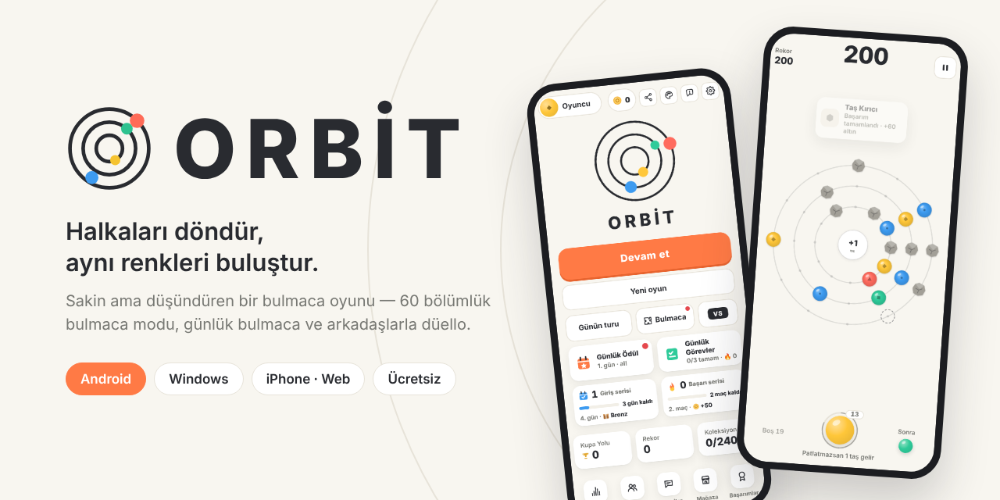
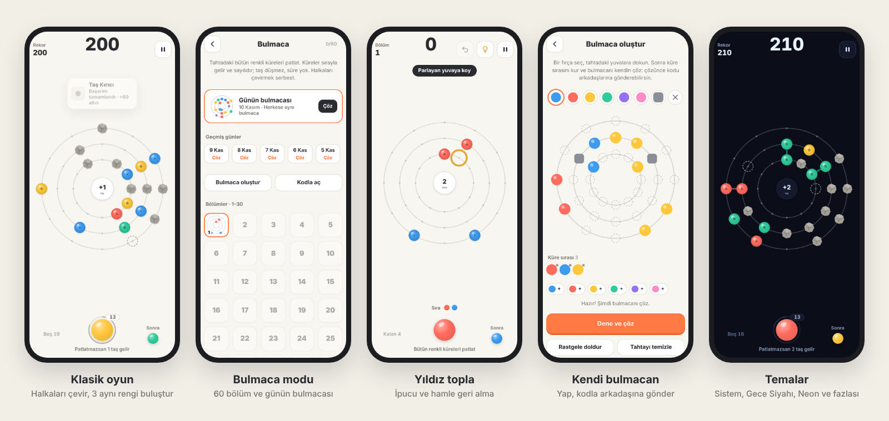

  

  
  
  

  
  
  

**ORBİT**, üç halkayı döndürüp aynı renkteki küreleri buluşturduğun sakin ama düşündüren bir bulmaca oyunu. Sıradaki küreyi boş bir yuvaya koy; değen üç aynı renk patlar. Patlatamazsan tahtaya taş gelir. Halkaları çevirmek ücretsiz, asıl ustalık doğru anda doğru halkayı çevirmekte.

  

## Neler var

| | |
|---|---|
| 🧩 **Bulmaca modu** | 60 bölüm, her bölümde 1–3 yıldız, ipucu ve hamle geri alma |
| 📅 **Günün bulmacası** | Herkese aynı bulmaca, seri sayacı, son 14 günün arşivi ve arkadaşlarının sonuçları |
| ✏️ **Kendi bulmacan** | Tahtayı fırçayla kur, kendin çöz; kısa bir kodla ya da bağlantıyla arkadaşına gönder |
| ⚔️ **Düello ve arkadaşlar** | Arkadaş ekle, mesajlaş, aynı tahtada skor yarışı yap |
| 🏆 **Sıralama ve başarımlar** | Rekor, günün turu ve bulmaca sıralamaları; Kupa Yolu, günlük görevler, giriş serisi |
| 🎨 **Temalar ve koleksiyon** | Sistem, Karanlık, Gece Siyahı, Lavanta, Kum, Neon; küre ve tahta görünümleri |
| 📸 **Skor kartı** | Tur sonunda skorunu resimli kart olarak paylaş |
| ☁️ **Bulut kaydı** | Google ya da kullanıcı adıyla giriş yap, ilerlemen bütün cihazlarında |
| 🖥️ **Bilgisayarda rahat** | Fare tekerleği halkayı çevirir, ok tuşlarıyla oyna, Enter yeni tur, F11 tam ekran |

## İndir ve kur

### 🤖 Android
**[ORBIT.apk'yı indir](https://raw.githubusercontent.com/dragony1905/apk/main/ORBIT.apk)** · eski sürümler: [Releases](../../releases)

1. APK dosyasını telefonda aç.
2. İstenirse o uygulamaya (Chrome, Dosyalar vb.) **"Bilinmeyen uygulamaları yükle"** izni ver.
3. Play Protect uyarısı çıkarsa **"Yine de yükle"**ye dokun. Bu uyarı mağaza dışından gelen her uygulamada çıkar.

Yeni sürüm eskisinin üstüne kurulur, ilerlemen silinmez. 2.3.0'dan beri oyun güncellemeleri kendisi bulur: **Ayarlar → Güncellemeler**.

### 🪟 Windows
**[ORBIT-Setup.exe'yi indir](https://raw.githubusercontent.com/dragony1905/apk/main/ORBIT-Setup.exe)** · Windows 10 ve 11

1. Dosyayı aç. Yönetici izni gerekmez; ORBİT Başlat menüsüne eklenir.
2. Windows "Bilgisayarınız korundu" derse **Ek bilgi → Yine de çalıştır**. Kurulum dosyası dijital olarak imzalı olmadığı için bu uyarı çıkar.
3. Google ile giriş bilgisayarın kendi tarayıcısında yapılır, sonra oyuna otomatik dönülür.
4. Yeni sürüm çıkınca uygulama haber verir; indirir, doğrular ve kendisi kurar.

### 🍎 iPhone, iPad ve tarayıcı
**[orbit-pocket-play.lovable.app](https://orbit-pocket-play.lovable.app)**

- iPhone/iPad: sayfayı **Safari**'de aç → **Paylaş** → **Ana Ekrana Ekle** → **Ekle**. ORBİT ana ekranda uygulama gibi tam ekran açılır, internetsiz de oynanır.
- Web sürümü her açılışta en son sürümü yükler. İlerleme o tarayıcıda saklanır; hesapla giriş yaparsan bulutta da.

## Kontroller

| | Dokunmatik | Bilgisayar |
|---|---|---|
| Halkayı çevir | Halkayı parmakla sürükle | Fare tekerleği ya da sürükle · ← → |
| Halka seç | — | ↑ ↓ |
| Küre koy | Boş yuvaya dokun | Boş yuvaya tıkla |
| Bulmacada geri al / ipucu | ↶ / 💡 düğmeleri | Ctrl+Z / H |
| Duraklat · yeni tur | ⏸ düğmesi | Esc · Enter |

## Sürüm notları
Her sürümün yenilikleri [Releases](../../releases) sayfasında ve oyunun içinde (**Ayarlar → Güncellemeler**) yazar.

<b>Güvenlik ve doğrulama</b>

- Her sürümün yanında `.sha256` dosyası vardır. Dosyanın değişmediğini doğrulamak için: `sha256sum ORBIT-<sürüm>.apk` (Windows'ta `certutil -hashfile ORBIT-Setup-<sürüm>.exe SHA256`). Çıkan değer `.sha256` dosyasındakiyle aynı olmalı.
- Kalıcı imza anahtarının SHA-1 parmak izi: `79:EF:FA:49:25:14:9A:AC:6D:72:12:25:9D:0C:5D:CC:98:89:D4:68`
- Uygulama içi güncelleme bu depodaki `guncelleme.json` dosyasını okur ve APK'yı yalnızca bu deponun `surumler/` klasöründen indirir. Kurmadan önce boyut, SHA-256, paket adı, sürüm kodu ve imza sertifikası kontrol edilir; biri tutmazsa dosya silinir ve kurulmaz. Kurulumu Android'in kendi onay ekranı yapar ve indirmeden önce kayıtların bir yedeği alınır.
- 2.2.0 ve öncesinde uygulama içi güncelleme yok: 2.3.0 ya da sonrasını bir kez elle kurman gerekir.
- **1.8.3'ten geçiyorsan:** 1.8.3 geçici bir anahtarla imzalıydı. Yeni sürümü kurmadan önce eski ORBİT'i **bir kez kaldırman** gerekir (o telefondaki misafir ilerlemesi silinir; hesapla giriş yaptıysan ilerlemen buluttan geri gelir).

<b>Bu depo hakkında</b>

- Bu depoda oyunun kodu bulunmaz; yalnızca derlenmiş Android ve Windows sürümleri, web sürümü (`docs/`) ve güncelleme bildirimi yayınlanır.
- Her zaman en son sürüm: [`ORBIT.apk`](https://raw.githubusercontent.com/dragony1905/apk/main/ORBIT.apk) ve [`ORBIT-Setup.exe`](https://raw.githubusercontent.com/dragony1905/apk/main/ORBIT-Setup.exe). Oyundaki QR kodu da bu adresleri açar.
- Gizlilik: [GIZLILIK.md](GIZLILIK.md)

---

🇬🇧 <b>English</b>

**ORBİT** is a calm but thoughtful puzzle game: rotate three rings and bring three spheres of the same color together. Place the next sphere in an empty slot — three touching spheres of one color pop. Miss, and a stone drops onto the board.

- **Puzzle mode:** 60 levels with 1–3 stars, hints and undo; a daily puzzle with streaks and a 14-day archive.
- **Make your own puzzle** and share it with a short code or link.
- Duels with friends, chat, leaderboards, achievements, themes and cloud save.
- Available in Turkish and English.

**Download:** [Android APK](https://raw.githubusercontent.com/dragony1905/apk/main/ORBIT.apk) · [Windows installer](https://raw.githubusercontent.com/dragony1905/apk/main/ORBIT-Setup.exe) · [Play in the browser / iPhone](https://orbit-pocket-play.lovable.app)

